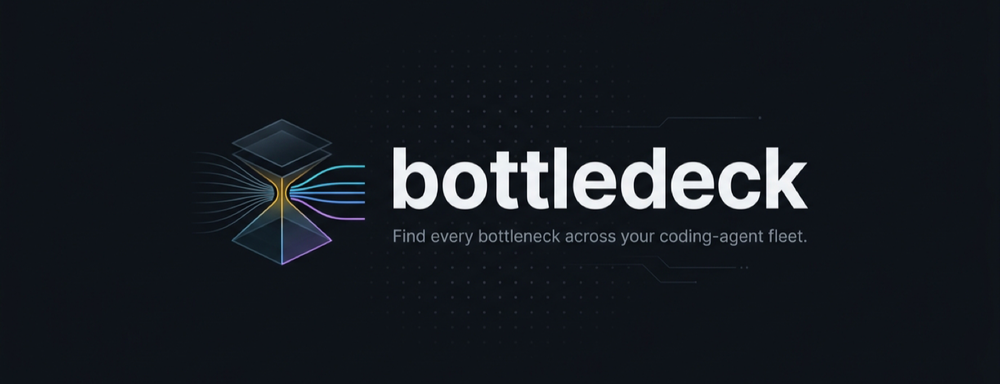
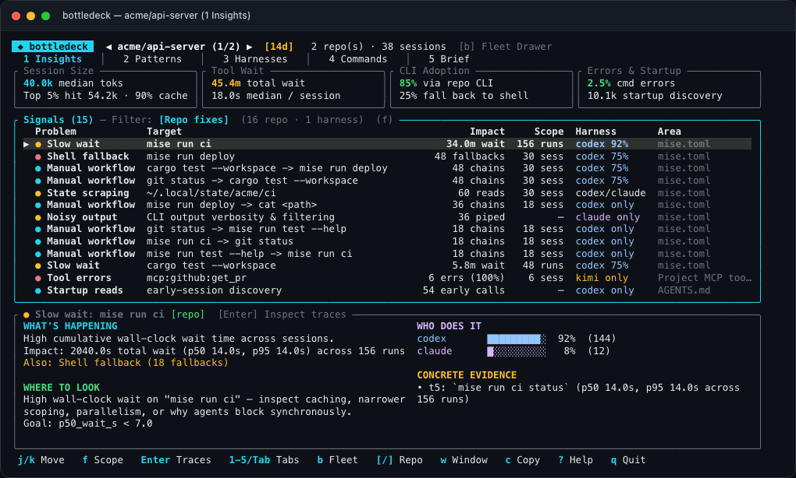
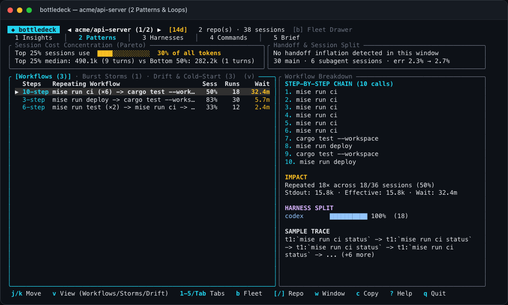
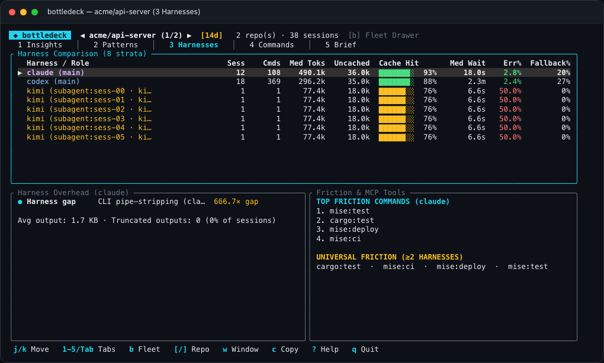

<div align="center">



<p>
  <strong>Offline Rust CLI &amp; Ratatui TUI that mines local coding-agent transcripts to expose wasted tokens, polling loops, and failing tools.</strong>
</p>

<p>
  <a href="https://github.com/timuric/bottledeck/releases"></a>
  <a href="https://github.com/timuric/bottledeck/actions/workflows/ci.yml"></a>
  <a href="LICENSE"></a>
  
</p>

<p>
  <a href="#install">Install</a> &nbsp;·&nbsp;
  <a href="#interactive-tui">Dashboard</a> &nbsp;·&nbsp;
  <a href="#what-it-detects">Detectors</a> &nbsp;·&nbsp;
  <a href="#cli--agent-workflows">CLI</a> &nbsp;·&nbsp;
  <a href="#architecture--privacy">How It Works</a> &nbsp;·&nbsp;
  <a href="#upgrading">Upgrades</a>
</p>

</div>

---

## Why bottledeck?

Coding agents — **Claude Code**, **Codex**, **Antigravity**, and **Kimi Code** — quietly burn hours and millions of tokens on avoidable friction: polling loops waiting on CI, verbose CLI stdout piped through `grep`/`tail`, shell fallbacks when a project CLI omits a field, raw state-file scraping, repeated `--help` lookups, and failing MCP tools.

`bottledeck` reads the session transcripts already on your machine into a single incremental SQLite WAL ledger — **100% offline, zero per-repo instrumentation, zero cloud telemetry**. It collapses ephemeral git worktrees into one logical repository, pinpoints what is broken and which harness is doing it, exports an evidence-backed diagnosis brief you can paste straight back to an agent, and verifies whether your fix actually worked (`--since <commit>`).

---

## Interactive TUI

Run `bottledeck` in any terminal to sync local transcripts and open the dashboard:

<p align="center">
  
</p>

<details>
<summary><strong>More dashboard views</strong> — Tab 2 (Patterns &amp; Loops) and Tab 3 (Side-by-side Harnesses)</summary>

<br />

**Tab 2 · Patterns & Loops** — Pareto session cost concentration, recurring multi-step call chains, burst storms, and drift/cold-start regressions:



<br />

**Tab 3 · Harnesses** — Side-by-side Claude vs Codex vs Kimi comparison with prompt cache-hit bars, error/fallback rates, and universal friction commands:



</details>

### Keybindings

| Key | Scope | Action |
| :--- | :--- | :--- |
| `1`–`6` / `Tab` / `Shift-Tab` | Global | Switch views (`1 Insights`, `2 Patterns`, `3 Harnesses`, `4 Commands`, `5 Brief`, `6 Issues`) |
| `j` / `k` / `↑` / `↓` | Global | Navigate rows or scroll (`PgUp`/`PgDn`, `g`/`G` to jump) |
| `Enter` | `1 Insights` | Open redacted trace drill-down for the selected signal (or pick repo in drawer) |
| `f` | `1 Insights` | Cycle scope filter (`Repo fixes` → `All signals` → `Harness overhead`) |
| `v` | `2 Patterns` | Cycle view (`Workflows` → `Burst Storms` → `Drift & Cold-Start`) |
| `s` | `4 Commands` | Cycle sort/view (`Token Sinks` → `Slowest` → `Most Errors` → `MCP`) |
| `m` | `5 Brief` | Toggle `Diagnosis Prompt` (Markdown) vs `Structured YAML` |
| `m` / `u` | `6 Issues` | Mark a fix for the selected issue *now* / undo the last mark |
| `o` | `6 Issues` | Show only open issues (regressed, new, active, unchanged, improved) |
| `b` | Global | Toggle Fleet Repos & Cross-Repo drawer (`h`/`l` switches focus) |
| `[` / `]` | Global | Step to previous / next repository inline |
| `w` | Global | Cycle time window (`24h` → `7d` → `14d` → `30d` → `all`) |
| `r` | Global | Re-sync local transcripts into the SQLite ledger live |
| `c` | Global | Copy active Brief (Prompt or YAML) to clipboard (`pbcopy` / `wl-copy` / `xclip`) |
| `?` / `Esc` / `q` | Global | Toggle help overlay / close modal or drawer / quit |

---

## Install

Prebuilt binaries are published on GitHub Releases for **macOS** (`aarch64`, `x86_64`) and **Linux** (`x86_64`, `aarch64`), with SHA256 verification.

**Quick install (macOS & Linux):**

```sh
curl -fsSL https://raw.githubusercontent.com/timuric/bottledeck/main/install.sh | sh
```

> Installs to `~/.local/bin/bottledeck` by default. Set `BOTTLEDECK_INSTALL_DIR` or `BOTTLEDECK_VERSION` to customize.

**Homebrew:**

```sh
brew tap timuric/bottledeck https://github.com/timuric/bottledeck
brew install bottledeck
```

**Cargo (from source):**

```sh
cargo install --git https://github.com/timuric/bottledeck
```

### Upgrading

```sh
bottledeck update           # downloads latest release, verifies SHA256SUMS.txt, atomically swaps binary
bottledeck update --check   # check for a newer release without installing
```

- **Homebrew installs:** Run `brew upgrade bottledeck`. `bottledeck update` automatically detects Homebrew-managed binaries and tells you instead of overwriting them (pass `--force` to override).
- **Non-blocking update notices:** The TUI header and `bottledeck doctor` run a cached 24-hour check in a background thread. Set `BOTTLEDECK_NO_UPDATE_CHECK=1` (or `CI=1`) to disable it completely.

---

## Supported Harnesses

`bottledeck` auto-discovers local transcript directories on startup — run `bottledeck doctor` to see what was detected on your machine.

| Harness | Auto-Discovered Roots | Override Env Var |
| :--- | :--- | :--- |
| **Claude Code** | `~/.claude/projects` | `BOTTLEDECK_CLAUDE_DIR` |
| **Codex** | `~/.codex/sessions`, `~/.codex/archived_sessions`, `~/.t3/userdata/providers/codex` | `BOTTLEDECK_CODEX_DIR` |
| **Antigravity / T3 Code** | `~/.t3/userdata`, `~/.gemini/antigravity`, `~/.gemini/antigravity-cli`, `~/.gemini/antigravity-ide` | `BOTTLEDECK_ANTIGRAVITY_DIR` |
| **Kimi Code** | `~/.kimi-code/sessions`, `~/.kimi/sessions` | `BOTTLEDECK_KIMI_DIR` |
| **Optional CLI Wrapper** | `~/.local/state/bottledeck/spans.jsonl` (via `bottledeck wrap`) | `BOTTLEDECK_STATE_DIR` |

> Need exact wall-clock durations or surface-version tags for a custom script or CLI? Prefix any command with the fail-open wrapper:
> `bottledeck wrap --surface v2 -- mise run test`

---

## What It Detects

Signals are automatically split into **repo-level fixes you control** and **harness/runtime overhead**, so you never waste time debugging agent-runtime quirks as repo bugs.

| Repo & Workflow Fixes (`opp-*`) | Harness & Runtime Overhead (`h-*`) |
| :--- | :--- |
| **Polling loops** — repeated `status`/`logs`/`sleep` checks instead of blocking waits | **Harness-internal waits** — wall-clock latency inside harness-managed commands rather than repo tasks |
| **Shell fallbacks** — raw shell follow-ups right after a repo CLI/task omits needed fields | **Context handoff bloat** — continued/handoff threads burning far more tokens than fresh sessions |
| **State scraping** — reading internal state files directly instead of calling a CLI | **Low cache efficiency** — low prompt cache hit rates multiplying uncached token cost |
| **Noisy & verbose output** — oversized stdout payloads or CLI output piped through `grep`/`tail`/`sed` | **Harness divergence** — large cost, wait, error, or pipe-stripping gaps between harnesses on the same repo |
| **Startup reads & file re-reads** — early-session discovery churn and repeated reads of the same files | |
| **Tool & MCP errors** — failing or truncated non-shell/MCP tool calls and high-failure commands | |
| **Manual workflows** — repeating 3–10 step command chains ready for a single composite task | |
| **Flag guessing & `--help` tax** — invalid flag retries and repeated `--help` lookups | |

---

## CLI & Agent Workflows

Every analytical command auto-syncs incrementally (pass `--no-sync` to skip) and supports `--window <24h|7d|14d|30d|all>`, `--since`, `--until`, and `--format <md|json>`. `--since`/`--until` take an ISO date, a relative duration (`48h`), or a git commit/ref, so "everything after this fix" is `--since <sha>`.

### Teach your agents to use it

```sh
bottledeck agent-guide            # Print the agent guide: question → command map, time scoping, verdicts, gotchas
bottledeck agent-guide --install  # Install it as a skill for Claude Code ($CLAUDE_CONFIG_DIR or ~/.claude) and Codex ($CODEX_HOME or ~/.codex)
```

Once the skill is installed, asking an agent "did the polling fix in quineos stick?" or "what wasted the most tokens in this repo last week?" is enough: the agent knows to sync once, name the repo, scope the time range, and pick `issues`, `report`, `tools`, or `diff`. Agents that only see `bottledeck --help` are pointed at `agent-guide` too. `bottledeck doctor` shows whether the installed skill matches the binary version; re-run `--install` after upgrading.

### 1. Hand an evidence-backed diagnosis brief straight to an agent

```sh
# Open-ended diagnosis prompt with repo signals, patterns, and harness splits
bottledeck report --repo . --format prompt | pbcopy

# Compact structured YAML brief (token-efficient for automation)
bottledeck report --repo . --format llm

# Fleet-wide overview across all repos (Markdown or JSON)
bottledeck report --all --window 14d
```

> Running `bottledeck` with no subcommand opens the TUI when attached to a terminal, or prints a Markdown fleet report when piped.

### 2. Verify fixes after an infrastructure commit

`--since` and `--until` accept **git commit SHAs/refs**, ISO dates, or relative durations (e.g. `48h`):

```sh
# Before/after comparison around a commit SHA or date
bottledeck diff --repo . --since 9f2a1c4

# Restrict any report or inspection to sessions after a commit
bottledeck report --repo . --since 9f2a1c4
bottledeck commands --repo . --since 2026-11-20 --until HEAD
```

### 3. Track issues session by session

`--since` compares aggregates. `issues` asks the sharper question: **after a fix, do new sessions still hit the same issue?** Every issue gets a stable key (`<kind>:<target>`, e.g. `polling_tax:gh run view`) and a strip with one cell per session that *could* have hit it — `●` affected, `○` clean, `│` fix marker. Sessions that never did the relevant work (never ran the polled command, never called the tool) are excluded, so unrelated sessions can't make an issue look fixed.

```sh
bottledeck issues --repo .                      # every trackable issue, problems first
bottledeck issues --repo . --open               # only issues that still need attention
bottledeck issues "gh run view" --repo .        # one issue (key, unique substring, or opp-N)
bottledeck mark polling_tax:gh run view --at 9f2a1c4 --note "added mise run ci-wait"
bottledeck mark --all --at 2026-11-25 --note "codex 0.171 upgrade"   # repo-wide marker
bottledeck mark --list --repo .   /   bottledeck mark --remove 3 --repo .
```

| Verdict | Meaning |
| :--- | :--- |
| `GONE` | 0 hits since the marker, in enough sessions that this would be < 5% likely at the old rate |
| `IMPROVED` / `REGRESSED` | the post-marker rate is significantly lower / higher (exact binomial test, p ≤ 0.05) |
| `UNCHANGED` | enough post-marker sessions, no significant change |
| `WAITING` | too few exposed sessions since the marker to tell — the report says how many more are needed |
| `QUIET` | no marker, but the clean streak since the last hit is unlikely by chance — mark the fix to confirm |
| `ACTIVE` / `NEW` | no marker and still recurring / only present in the newest sessions |

Each issue also shows a per-harness verdict and an affected/exposed breakdown per **harness version** (Claude Code and Codex record theirs; run `bottledeck sync --force` once to backfill older sessions), so a harness release that fixes or breaks something shows up directly. Fleet-level comparisons (`harness_divergence`, `low_cache_efficiency`, `missing_composite_task`, `slow_task_latency`, `context_handoff_bloat`) aren't per-session events and stay in `report`.

### 4. Deep inspection

```sh
bottledeck inspect opp-1 --repo . --samples 5            # Redacted traces for opp-N/h-N, an issue key, or a command
bottledeck patterns --repo .                             # Pareto split, motifs, burst storms, drift, harness gaps
bottledeck sequences --repo . --min-len 3 --min-sessions 2  # Repeating multi-step command workflows
bottledeck tools --repo . --mcp-only                     # MCP & non-shell tool errors, sizes, truncation (+ totals)
bottledeck commands --repo . --sort effective            # Sort by effective | tokens | wait | runs | errors | pipes
bottledeck errors --repo .                               # Recurring nonzero-exit error clusters
bottledeck bypasses --repo .                             # State scrapes, pipe-stripping, help tax, shell rebounds
bottledeck sessions --repo . --sort tokens               # Top sessions by tokens | wait | stdout | errors
```

### 5. Inventory & diagnostics

```sh
bottledeck repos          # List every discovered repository and worktree count
bottledeck sync [--force] # Incrementally ingest transcripts (or force full re-parse)
bottledeck doctor         # Verify detected harness roots, ledger size, and version
```

---

## Architecture & Privacy

```text
  Local Transcripts (read-only)                    Local SQLite WAL Ledger
  ─────────────────────────────                    ───────────────────────
  ~/.claude/projects          ─┐
  ~/.codex/{sessions,archived} ├─► Incremental Parser ─► ~/.local/state/bottledeck/ledger.db
  ~/.t3/userdata · ~/.gemini   │   · mtime/size watermark         │
  ~/.kimi{-code,}/sessions     │   · git-common-dir repo ID       ├──► Ratatui TUI (`bottledeck`)
  spans.jsonl (optional wrap) ─┘   · secret redaction             ├──► Reports (`md` / `llm` / `prompt` / `json`)
                                                                  └──► Post-commit `diff` & trace `inspect`
```

- **100% local data plane:** Transcripts are read locally and stored in `~/.local/state/bottledeck/ledger.db`. Nothing is uploaded, indexed remotely, or shared.
- **Worktree normalization:** Uses `git-common-dir` and normalized remote URLs (plus a cached fallback for deleted ephemeral worktrees) to merge all worktrees of a repo into a single logical `repo_id`.
- **Automatic secret redaction at ingest:** Commands and stderr previews are scrubbed before hitting disk — stripping `Bearer`/`Basic` auth headers, common provider keys (`sk-*`, `gh*_*`, `xox*-*`, `AKIA*`, `AIza*`), credentials in URLs, and sensitive env/flag assignments (`TOKEN`, `SECRET`, `PASSWORD`, `API_KEY`, `AUTH`, `COOKIE`).
- **Minimal, opt-out network footprint:** The only network requests `bottledeck` ever makes are to GitHub Releases (`api.github.com` / `github.com`) for `bottledeck update` and the optional 24-hour update check (`BOTTLEDECK_NO_UPDATE_CHECK=1` disables it).

---

## Configuration

Multi-directory variables accept standard `PATH` separators (`:` on macOS/Linux).

| Variable | Default | Purpose |
| :--- | :--- | :--- |
| `BOTTLEDECK_STATE_DIR` | `~/.local/state/bottledeck` | Directory for `ledger.db`, `spans.jsonl`, and update cache |
| `BOTTLEDECK_CLAUDE_DIR` | `~/.claude/projects` | Override Claude Code transcript root(s) |
| `BOTTLEDECK_CODEX_DIR` | `~/.codex/sessions:...` | Override Codex transcript root(s) |
| `BOTTLEDECK_ANTIGRAVITY_DIR` | `~/.t3/userdata:...` | Override Antigravity / T3 Code transcript root(s) |
| `BOTTLEDECK_KIMI_DIR` | `~/.kimi-code/sessions:...` | Override Kimi Code transcript root(s) |
| `BOTTLEDECK_NO_UPDATE_CHECK` | *(unset)* | Set to `1` to disable daily GitHub Releases update checks |
| `BOTTLEDECK_ACTOR` | *(auto-detected)* | Tag `bottledeck wrap` spans (`human`, `ci`, or agent name) |
| `BOTTLEDECK_SURFACE` | *(unset)* | Default `--surface` label for `bottledeck wrap` |
| `BOTTLEDECK_SESSION_ID` | *(unset)* | Attach a session ID to `bottledeck wrap` spans |
| `BOTTLEDECK_TOOL_CALL_ID` | *(unset)* | Attach a tool call ID to `bottledeck wrap` spans |
| `BOTTLEDECK_INSTALL_DIR` | `~/.local/bin` | Target directory for `install.sh` |
| `BOTTLEDECK_VERSION` | *(latest)* | Pin a release tag for `install.sh` (e.g. `v0.1.0`) |

---

## Contributing & Releasing

Contributions, bug reports, and new harness adapters are welcome — see [CONTRIBUTING.md](CONTRIBUTING.md).

**Maintainer release flow:**

```sh
./scripts/release.sh 0.2.0
```

Bumps `Cargo.toml`, runs `cargo check` and `cargo test`, commits and tags `v0.2.0`, and pushes. [`.github/workflows/release.yml`](.github/workflows/release.yml) then builds macOS & Linux binaries, publishes `SHA256SUMS.txt` on GitHub Releases, and updates `Formula/bottledeck.rb` automatically.

## License

[MIT](LICENSE)
